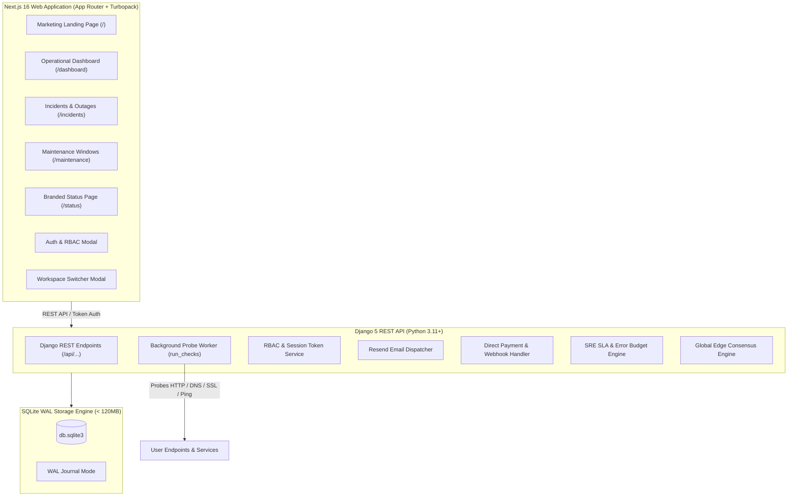

# Sentiro (sentiro.xyz) 🛡️

> **The 24/7 IT Sentinel • Ultra-Lean Synthetic Uptime & Edge Consensus Monitoring.**  
> A high-performance, self-hostable alternative to UptimeRobot, BetterStack, Datadog Synthetics, and Pingdom designed to run on a 1 vCPU / 512 MB VPS or [Pxxl (`pxxl.app`)](https://pxxl.app) consuming under **120 MB RAM**.

[](https://opensource.org/licenses/MIT)
[](https://www.python.org/)
[](https://www.djangoproject.com/)
[](https://nextjs.org/)
[](https://tailwindcss.com/)
[](https://pxxl.app)
[](#-fair-naira-pricing--radical-economics)

---

## 📖 Documentation Wiki & Deployment Guides
- **[Documentation Wiki (`wiki/`)](wiki/Home.md)**:
  - 🚀 **[Pxxl Cloud Deployment (`PXXL_DEPLOY.md`)](PXXL_DEPLOY.md)**: Deploying frontend & backend to `pxxl.app` with custom domains.
  - 💳 **[Bachs Billing & Monetization (`wiki/Bachs-Billing-Integration.md`)](wiki/Bachs-Billing-Integration.md)**: Complete guide per [docs.bachs.io](https://docs.bachs.io) (checkout sessions, webhooks, NGN ₦2k/₦5k tiers).
  - 🤖 **[Telegram Alert Bot (`wiki/Telegram-Alert-Bot.md`)](wiki/Telegram-Alert-Bot.md)**: Official `@SentiroAlertBot` guide (zero per-message fees, Chat ID only).
  - 🛡️ **[SRE Architecture & Security (`wiki/Architecture-and-Security.md`)](wiki/Architecture-and-Security.md)**: SQLite WAL, consensus quorum, TOTP 2FA, and Audit Logs.

---

## ⚡ Executive Summary & Radical Economics

Sentiro was built to solve the exorbitant operational overhead and currency barriers of legacy monitoring software:

- **Zero Hosted Database Costs**: Backed by **SQLite in WAL mode** (`PRAGMA journal_mode=WAL;`), providing high-concurrency read-heavy throughput without paying $50–$300/month for managed Postgres or time-series clusters.
- **Ultra-Lean Resource Footprint**: Consumes under **120 MB RAM** on a standard $3/month VPS or cloud container platform like [Pxxl (`pxxl.app`)](https://pxxl.app).
- **Consensus Probing Engine**: Eliminates false midnight alerts by confirming outages across multiple edge nodes (Lagos, Frankfurt, N. Virginia, London) before triggering escalations.
- **Fair Nigerian Naira SaaS Pricing via Bachs**: Protects teams from US Dollar exchange shocks ($35–$80/mo = ₦55,000–₦125,000/mo).
- **Official Telegram Bot (@SentiroAlertBot)**: Instant incident dispatch with zero per-message fees—users only need their Chat ID.

```
+---------------------------------------------------------------------------------------------------+
|                                      SENTIRO PLATFORM TIERS                                       |
+---------------------------------------------------------------------------------------------------+
| Feature                      | Community (₦0/mo)     | Indie Pro (₦2,000/mo)  | Team Pro (₦5,000/mo)      |
+------------------------------+-----------------------+------------------------+---------------------------+
| Target Audience              | Self-hosters & Devs   | Indie Hackers & MVPs   | Agencies & Distributed Dev|
| Annual Rate (20% Off)        | ₦0 / forever          | ₦20,000 / year         | ₦50,000 / year            |
| Check Frequency              | 60s to 3 min          | ⚡ 30 Seconds           | 🚀 10 Seconds             |
| Multi-Workspace Management   | 1 Workspace           | Up to 5 Workspaces     | 👥 Unlimited Workspaces   |
| Global Edge Consensus Probes | Single Node (Local)   | 🌍 4 Regional Nodes    | 🌐 6 Edge Regions (Global)|
| Contractual SLA Reports      | Manual JSON Export    | ✅ Live SLA & Budget   | ✅ Attestation PDF & CSV  |
| Incident AI Root-Cause (RCA) | Optional (BYO Key)    | ✅ Unlimited AI RCA     | ✅ Unlimited AI RCA        |
| Alert Notification Channels  | Email, Slack, Webhook | + @SentiroAlertBot     | + Voice Call Escalation   |
| Historical Data Retention    | 30 Days               | 📈 1 Year (365 Days)   | 🏆 Multi-Year Rollups     |
| Team Access Control (RBAC)   | 1 Admin               | 5 Team Seats           | 👥 Unlimited (Granular)   |
| Bachs Checkout (docs.bachs.io)| Free Tier            | Instant Transfer ₦2,000| Instant Transfer ₦5,000  |
+---------------------------------------------------------------------------------------------------+
```

---

## 🏛️ System Architecture

PulseWatch uses an open-core monorepo architecture:



---

## 🌟 Key Features

### 1. Multi-Workspace Management (Pro Tier)
- Seamlessly isolate environments (e.g. *Production Cloud*, *Client Staging*, *Internal Infra*).
- Switch active workspaces in 1 click from the sidebar.
- Enforced quota gating: Community tier includes 1 workspace; Indie Pro & Team Pro unlock multi-tenancy.

### 2. Multi-Region Global Edge Consensus Probes
- Real-time probe benchmarks across 4 globally distributed edge locations:
  - 🇳🇬 **Africa (Lagos, LOS)**
  - 🇩🇪 **Europe (Frankfurt, FRA)**
  - 🇺🇸 **US-East (N. Virginia, IAD)**
  - 🇸🇬 **Asia-Pacific (Singapore, SIN)**
- **Consensus Quorum**: Requires multi-node confirmation before firing incident alerts, preventing midnight false alarms from local ISP hiccups.

### 3. SRE Contractual SLA Compliance & Error Budget Tracking
- Automated tracking against target availability levels (99.0%, 99.9%, 99.99%).
- Real-time calculation of **allowed downtime minutes**, **actual downtime minutes**, and **remaining monthly error budget**.
- Official SLA Attestation generation (`SLA-YYYYMM-PW99`) with instant CSV and JSON exports.

### 4. 7 Comprehensive Probe Types
- **HTTP / HTTPS**: Custom methods (`GET`, `POST`, `HEAD`, `PUT`, `PATCH`, `DELETE`), expected HTTP status codes, custom JSON headers, and payload bodies.
- **Keyword Presence / Absence**: Validate response bodies using substring matches or regex patterns.
- **ICMP Ping**: Socket-level packet loss and round-trip time (RTT) tracking.
- **TCP / UDP Port Socket**: Monitor PostgreSQL (`5432`), MySQL (`3306`), Redis (`6379`), SSH (`22`), or any custom port.
- **TLS / SSL Expiry Warnings**: Automatic certificate expiration countdowns at 30, 14, 7, and 1 days.
- **DNS Record Verification**: Confirm `A`, `AAAA`, `CNAME`, `MX`, and `TXT` resolution.
- **Cron Job Heartbeat (Dead-Man's Switch)**: Ingest tokens (`/hb/<token>`) to alert when nightly scheduled backups or cron tasks fail to check in.

### 5. Multi-Channel Alert Routing & Escalations
- **Resend Email API**: High-deliverability transactional notifications and password resets.
- **Slack, Discord, Microsoft Teams, Telegram**: Native webhooks with interactive formatting.
- **Termii & Twilio**: SMS and WhatsApp alerts for mission-critical production outages.
- **Quiet Hours Protection**: Suppress non-critical notifications during off-hours (e.g., 23:00 to 07:00).

### 6. Billing & Subscription Management (₦2,000 & ₦5,000)
- Native checkout sessions in Nigerian Naira (₦2,000 / ₦5,000).
- Secure webhook listener (`/api/billing/webhook/`) for automated tier activation.
- One-click printable tax invoices with official tax identification codes.

---

## 🚀 Quick Start Guide

### Prerequisites
- **Python 3.11+**
- **Node.js 18+ & npm**
- **Git**

### Step 1: Clone the Repository

```bash
git clone https://github.com/dedcreator/PING-BUD.git
cd PING-BUD
```

### Step 2: Set Up the Django Backend

```bash
cd backend

# Create and activate virtual environment
python3 -m venv .venv
source .venv/bin/activate  # On Windows: .venv\Scripts\activate

# Install dependencies
pip install django djangorestframework django-cors-headers requests

# Run database migrations
pythonmanage.py migrate

# Seed sample monitors, projects, invoices, and demo users
python manage.py seed_demo_data

# Start the Django development server
python manage.py runserver 8000
```

The Django REST API will run at `http://127.0.0.1:8000`.

### Step 3: Run the Continuous Probe Worker (Optional Daemon)

In a separate terminal tab:

```bash
cd backend
source .venv/bin/activate
python manage.py run_checks
```

### Step 4: Set Up the Next.js Frontend

```bash
cd frontend

# Install npm dependencies
npm install

# Start Next.js with Turbopack
npm run dev
```

Open **`http://localhost:3000`** in your browser.

---

## ⚙️ Environment Variables

Create `.env` files in `backend/` and `frontend/` as needed:

### Backend (`backend/.env`)

```ini
# Django Settings
SECRET_KEY=your-secure-secret-key-pulsewatch-production
DEBUG=False
ALLOWED_HOSTS=127.0.0.1,localhost,api.sentiro.xyz

# Resend Email Integration (resend.com)
RESEND_API_KEY=re_your_api_key_here
DEFAULT_FROM_EMAIL=alerts@sentiro.xyz

# Direct Billing Integration
BILLING_API_KEY=sec_your_key_here
BILLING_WEBHOOK_SECRET=whsec_your_secret_here

# SQLite Database Location (Defaults to db.sqlite3 in backend directory)
SQLITE_DB_PATH=db.sqlite3
```

### Frontend (`frontend/.env.local`)

```ini
NEXT_PUBLIC_API_URL=http://127.0.0.1:8000
```

---

## 🌐 Open Source vs. Production Repository Strategy

A frequent question for SaaS builders:  
> **"Do I need a separate repo for the open-source version and for the production SaaS?"**

### The Recommended Pattern: Single Open-Core Monorepo
We recommend keeping a **single repository** (`Sentiro`), following the battle-tested playbook of **Supabase, PostHog, Plausible, and Grafana**:

1. **One Unified Codebase**:
   - The entire platform (Django backend, Next.js frontend, SQLite WAL engine) is contained in this repository under the **MIT License**.
   - Community self-hosters run the exact same clean code locally for free (`Community Edition`).
2. **Feature Gating via Configuration & Subscriptions**:
   - Cloud SaaS features (such as live payment processing, multi-region proxy consensus workers, and Resend production email gateways) are controlled via database tier flags and environment variables (`BILLING_API_KEY`, `RESEND_API_KEY`).
   - Self-hosters can bring their own SMTP credentials and run single-node checks, while your hosted service (`sentiro.xyz`) charges ₦2,000 / ₦5,000 for the managed infrastructure, SMS credits, and multi-region quorum nodes.
3. **Zero Maintenance Friction**:
   - You avoid the headache of maintaining two diverging repositories, cherry-picking commits, or manually syncing bug fixes between open-source and proprietary forks.

---

## 📡 REST API Reference

| Method | Endpoint | Description |
| :--- | :--- | :--- |
| `POST` | `/api/auth/login/` | Authenticate user & retrieve session/token |
| `GET` | `/api/projects/` | List all workspaces for the authenticated account |
| `POST` | `/api/projects/` | Create a new workspace (Pro tier entitlement check) |
| `GET` | `/api/monitors/` | List health monitors with 24h rolling uptime & latency |
| `POST` | `/api/monitors/` | Create a new health check probe |
| `GET` | `/api/monitors/<id>/edge-breakdown/` | Retrieve real-time 4-node multi-region edge benchmarks & consensus |
| `POST` | `/api/monitors/<id>/check-now/` | Trigger immediate synchronous probe execution |
| `GET` | `/api/sla/report/?target=99.9` | SRE SLA compliance attestation & error budget calculations |
| `GET` | `/api/export/incidents/?format=csv` | Download complete outage and incident log as CSV |
| `GET` | `/api/maintenance/` | List scheduled maintenance downtime windows |
| `GET` | `/api/billing/` | Retrieve subscription tier, quotas, and invoice history |
| `POST` | `/api/billing/checkout/` | Generate direct checkout session for ₦2,000 or ₦5,000 plans |
| `GET` | `/metrics` | Standard Prometheus metric feed for Grafana |
| `GET` | `/badge/<id>.svg` | Dynamic SVG status badge for GitHub READMEs |
| `GET` | `/hb/<token>/` | Dead-man's switch cron job heartbeat ingest |

---

## 📄 Documentation, Wiki & Deployment Guides

- **[Knowledge Base Wiki (`wiki/`)](wiki/Home.md)**:
  - [Pxxl Cloud Deployment (`PXXL_DEPLOY.md`)](PXXL_DEPLOY.md): Complete setup for `pxxl.app`.
  - [Bachs Monetization Guide (`wiki/Bachs-Billing-Integration.md`)](wiki/Bachs-Billing-Integration.md): Hosted checkout sessions & webhook integration ([docs.bachs.io](https://docs.bachs.io)).
  - [Telegram Bot Guide (`wiki/Telegram-Alert-Bot.md`)](wiki/Telegram-Alert-Bot.md): Alerts via `@SentiroAlertBot`.
  - [Architecture & Security Controls (`wiki/Architecture-and-Security.md`)](wiki/Architecture-and-Security.md): SQLite WAL, consensus quorum, TOTP 2FA, Audit Logs.
- [`features.md`](file:///Users/apple/Desktop/Pulsewatch/features.md): In-depth 7-section feature matrix and technical architecture specifications.
- [`PulseWatch_Platform_Feature_Guide.pdf`](file:///Users/apple/Desktop/Pulsewatch/PulseWatch_Platform_Feature_Guide.pdf): Executive PDF presentation guide detailing all platform features, workflows, and operations.

---

## 📜 License

This project is licensed under the **MIT License** — you are free to use, modify, distribute, and self-host Sentiro.
